# A tour of JustComets

What JustComets does and how you work with it, module by module - enough to know whether it is the program for you
without installing it. Every picture was made by the program itself, from made-up comets and a made-up night. Inside
the program, the **Documentation** tab has the whole user's manual, a reference of every control and node, tutorials
and a glossary.

[Back to the front page](README.md) &nbsp;&middot;&nbsp; [Release notes](RELEASE-NOTES.md) &nbsp;&middot;&nbsp;
[Download](../../releases)

**Contents**

- [A night with JustComets](#a-night-with-justcomets)
- [Observation Planner](#observation-planner)
- [Astrometry and Photometry](#astrometry-and-photometry)
- [Image Processing](#image-processing)
- [The whole program](#the-whole-program)
- [What JustComets needs](#what-justcomets-needs)

## A night with JustComets

JustComets has one module for each part of a night of comet and asteroid observing. Each is a tab of the main window,
and each works on its own: use the ones you need beside the programs you already have.

| Before the night | At the telescope | After the night |
| --- | --- | --- |
| **Observation Planner**: which targets, when and for how long; the plan exported for your capture program. | Your capture program (N.I.N.A., KStars/Ekos, CCDCommander, the ASIAIR) runs the plan. | **Astrometry and Photometry**: positions and magnitudes, the report to the MPC. **Image Processing**: the picture. |

The modules hand things on through files you keep: the plan file of the planner, the FITS frames of the night, the
reports and the pictures.

## Observation Planner

The planner answers one question: which comets and asteroids can I observe tonight, when, and for how long?

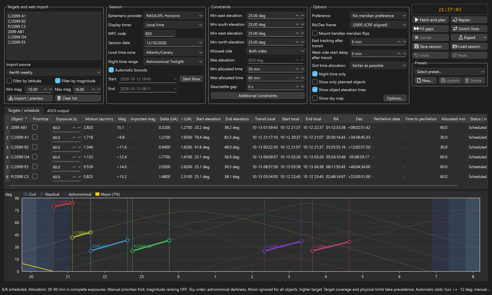

### Planning a night

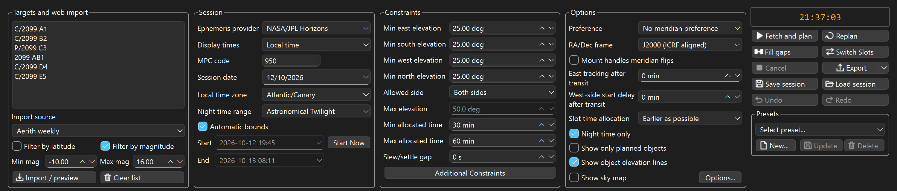

1. **Your site**: your MPC observatory code (its coordinates are downloaded once) and its time zone, with summer time.
2. **The night**: the evening it begins; it runs from sunset to sunrise, or between times you type. **Start Now**
   plans the rest of the night under way.
3. **The targets**: up to 80, typed by designation or name - comets (`10P`, `C/2026 A2`), numbered asteroids,
   provisional designations, names - or picked from lists: the comets of Seiichi Yoshida's weekly page (aerith.net),
   the MPC's possible comets, the newest comets, and catalogs of all asteroids, all comets and near-Earth asteroids,
   filtered by magnitude and by whether they rise at your site.
4. **The positions**: from the Minor Planet Center or NASA/JPL Horizons. The Sun and the Moon are computed on your
   computer.
5. **The rules** of your sky and your mount, and **Fetch and plan**.

### The rules of a plan

Each target gets one uninterrupted block of whole minutes. The planner fits as many targets as it can first, and only
then gives extra time to the ones you prioritize.

| Rule | What it means |
| --- | --- |
| Horizon | The lowest elevation to the east, south, west and north, joined smoothly: trees, roofs, haze. |
| Darkness | Blocks only while the Sun is low enough (astronomical twilight at first). |
| Block length | The shortest block worth making and the longest one, in whole exposures. |
| Gaps | Time between two blocks for the mount to move and settle. |
| Meridian | Whether a block may cross the meridian: freely when your mount flips by itself, or within limits you set after the transit. |
| One side | Only east or only west of the meridian, below a highest elevation. |
| Preferences | Avoid the Moon, prefer brighter targets. |

### Reading and changing the plan

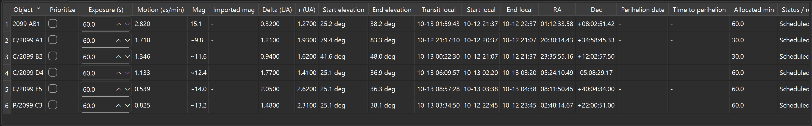

The table says, for each target, whether it was scheduled and if not why, its block, its elevation at both ends, its
transit, its position and motion, its predicted magnitude and its distances from the Earth and the Sun. Set the
exposure of each target in its row: the number of frames of its block follows from it.

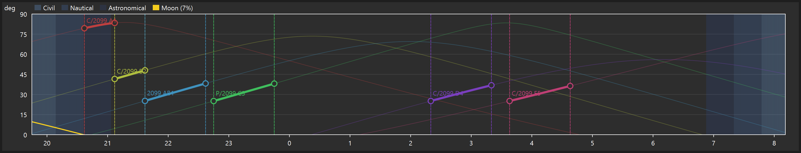

The graph shows the night with its twilight, the Moon and its phase, and every target's elevation, the blocks of the
plan drawn thick. Change the plan by hand in it:

- **drag a block** anywhere in its column - dropped on other blocks, the planner swaps or moves them aside so that
  everything still fits;
- **drag its start or end** to make it shorter or longer;
- **Fill gaps** stretches blocks into the free time beside them, **Switch Slots** swaps two targets' times, and
  **Undo** / **Redo** take changes back.

Every change by hand is checked against the same horizon, darkness and meridian rules as the plan.

**Sessions** keep a whole night - targets, exposures, rules, the fetched positions and your changes - and open again
without the internet. **Presets** keep the rules of a site or a setup under a name.

### Exporting the plan

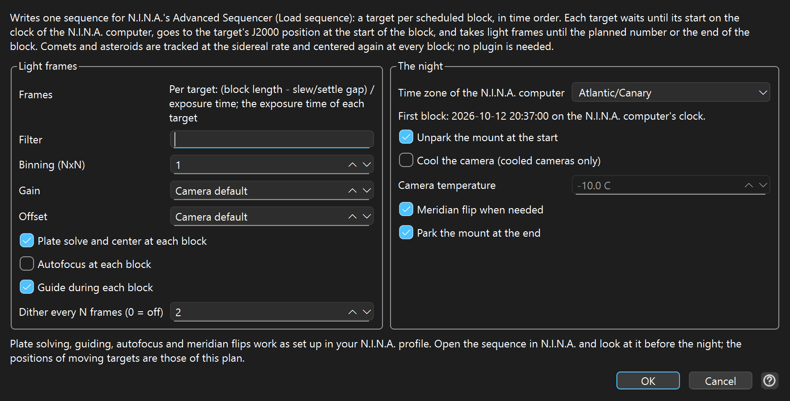

| Export | For | What it writes |
| --- | --- | --- |
| N.I.N.A. advanced sequence | N.I.N.A. 3.2 or later | One target per block, waiting for its start, slewing, plate solving and centering, autofocus and guiding when chosen, light frames until the block ends, meridian flips; unpark and park, cooling and warming. |
| StellarMate / Ekos plan | KStars/Ekos | A schedule with a capture sequence per target, with your folders, filter, camera format, gain, offset and the handling of aborted jobs. |
| CCDCommander plan | CCDCommander | A list of actions: wait, slew, plate solve and sync, images, guiding and dithering, a hard stop at the end of each block. |
| ZWO ASIAIR targets | The ASIAIR app | The targets and their positions, to paste into its plan. |
| ASCII table | Reading, printing | The rules, the blocks and the targets left out. |

Positions are J2000 at the start of each block (at its middle for the ASIAIR); each export asks for the time zone of
the computer that will run it and shows the first block on its clock.

## Astrometry and Photometry

Where was the comet, how bright was it, and the report for the Minor Planet Center.

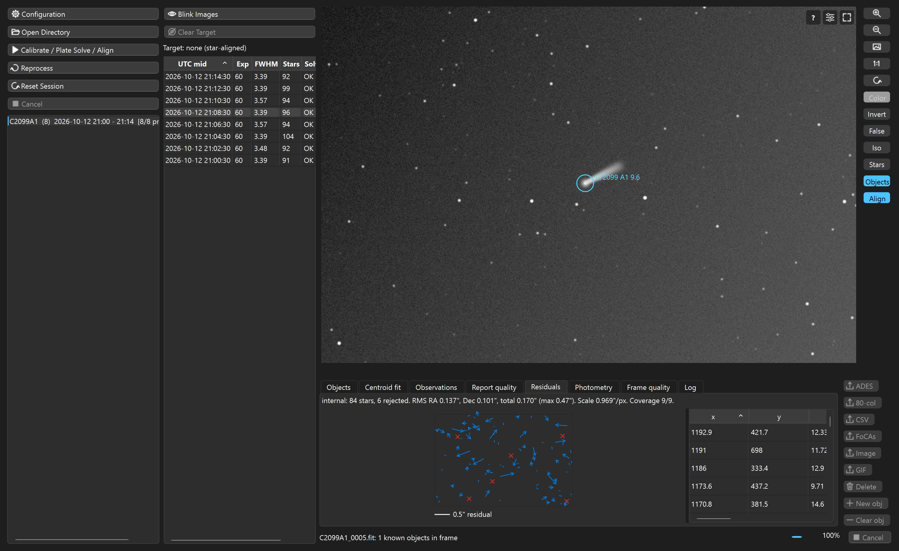

### Once: the configuration

Your MPC observatory code, the observer and measurer, the telescope and camera, the master calibration frames, where
the Gaia stars come from (VizieR or ARI Heidelberg over the internet, each field downloaded once and kept, or catalog
files on your computer), the plate solver (JustComets' own, ASTAP, or one then the other), the photometry settings and
the limits by which a report is graded.

### A session

1. **Open Directory**: the folder with the night's FITS frames, grouped into objects by their names.
2. **Calibrate / Plate Solve / Align**: every frame is calibrated, measured (stars, FWHM, background) and plate-solved
   against Gaia. The results go to a folder beside the frames: **your frames are never changed**. A second run does
   only what is not done yet.
3. **The known objects** in each frame, from the MPC's orbit files (and the MPC's candidates of the night): double-click
   your target, and its ephemeris gives the viewer its predicted place and every measurement its O-C.

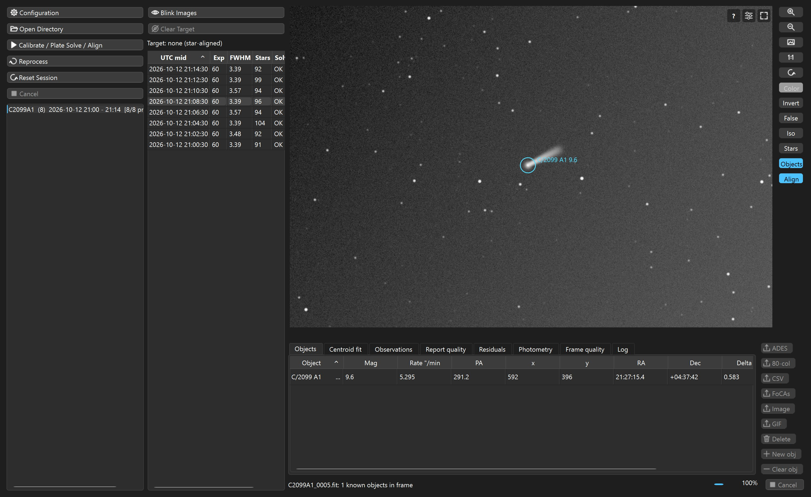

4. **Measure**: double-click the target in the viewer. The measurement snaps to the brightest point, fits its centroid
   and shows its profile, its position on the sky with the uncertainties, its FWHM, its signal-to-noise ratio and its
   O-C. **Accept** keeps it. A faint target is measured on a **stack** of frames, aligned on the target so that it
   stays sharp while the stars trail. An object that is in no list - a new one - is measured too, under a temporary
   designation of yours.

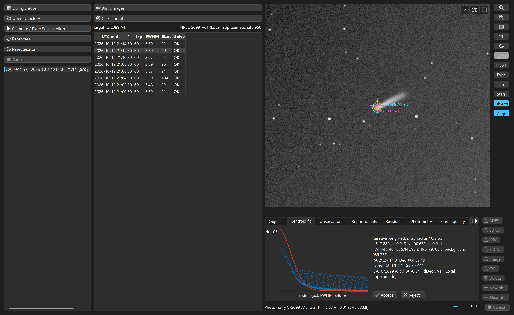

5. **Check** the observations and the report quality, then **report** and **send**.

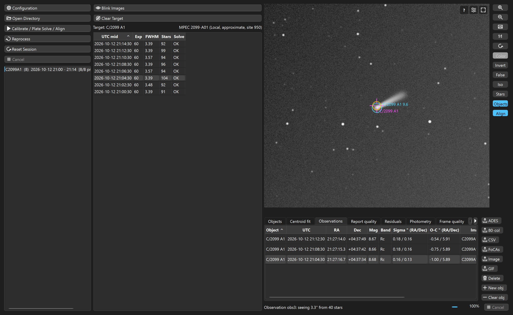

### Photometry and FoCAs

Every measurement also gives the target's magnitude: in an aperture with the sky from a ring around it, against Gaia
stars of solar color in the same frame, in the R band. For a comet the aperture is a fixed size at the comet (10,000
km at first). For comets JustComets also measures the photometry of **FoCAs**, the method of the Spanish group
Cometas_Obs - magnitudes in boxes of 10 to 60 arcseconds and Afrho - and writes the session's FoCAs report.

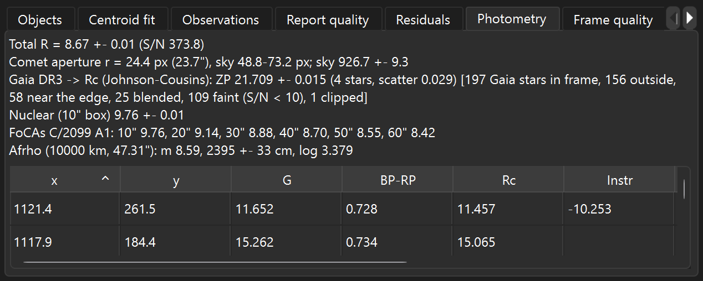

### Reports and sending to the MPC

**Report quality** grades a report before you send it: the scatter of the positions around a smooth motion, the O-C
against the ephemeris, a timing offset along the motion, the plate solutions and the photometric zero points - each
**Good**, **Check** or **Poor**, with notes on what to look at.

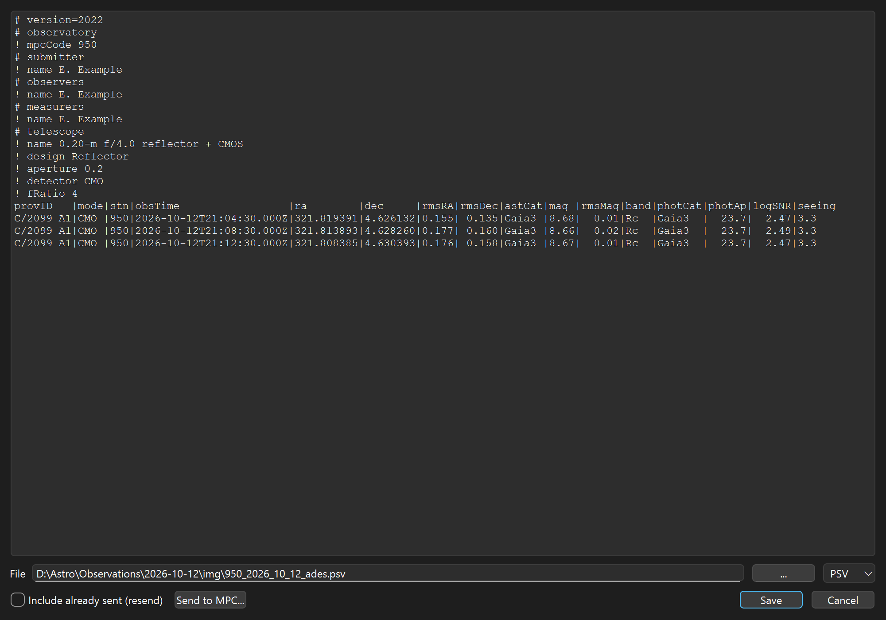

Reports in **ADES** (PSV or XML) or the older **80-column** format open in a preview first, and are saved beside the
night. **Send to MPC...** shows exactly what will be sent and where; only **Confirm send** sends it - to the MPC's test
service at first, which checks a report without keeping it, and to the production service when your reports are
right. Every send is recorded, and accepted observations are never sent twice by mistake.

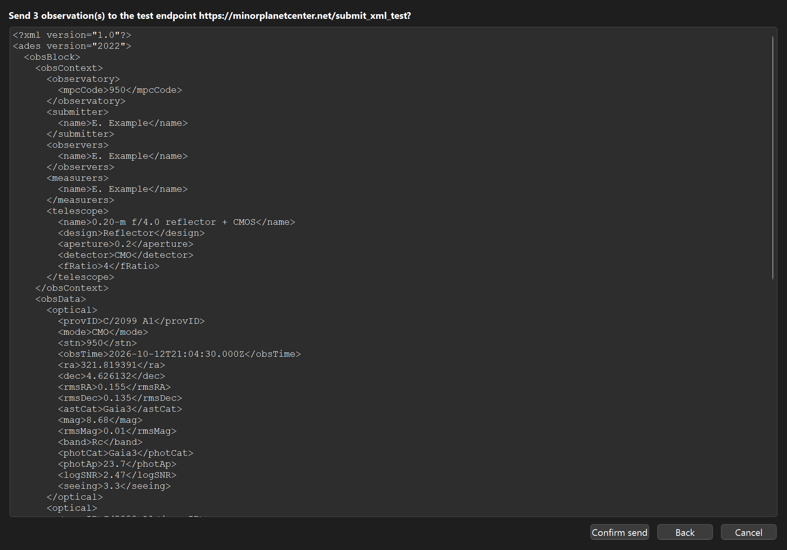

### Comparing stations

Your positions of an object compared with those other observatories reported to the MPC in the same weeks, each
against JPL Horizons for its own site: the difference is your own systematic offset - a timing error, a catalog
problem, or the way you measure a coma.

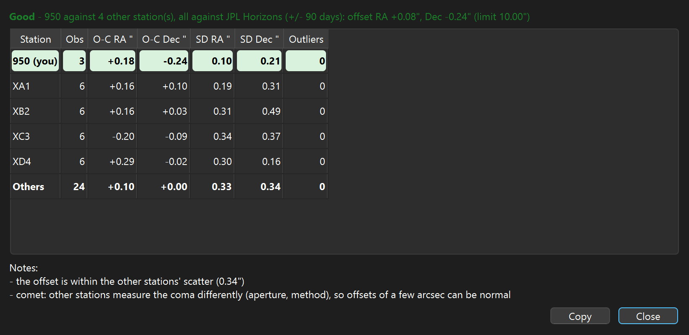

### Also

- **The viewer**: zoom, 1:1, rotation, color, invert, false color and isophotes, the solution's stars and the known
  objects marked, frames that stay aligned on the stars or on the target, blinking, a display stretch that never
  changes a measurement.
- **Annotated images** of an observation as JPG, PNG or TIFF, and **animated GIFs** of an object's observations.
- **Offline**: with the Gaia stars of a field kept, or with catalog files, plate solving and measuring need no internet.

## Image Processing

From the frames of a night to a finished picture, as a **network of nodes**: each step is a node, the nodes are linked
into a network you see and change as a whole, and the network keeps the recipe, not only the result. A node never
changes the files it reads, and every step can be changed again later.

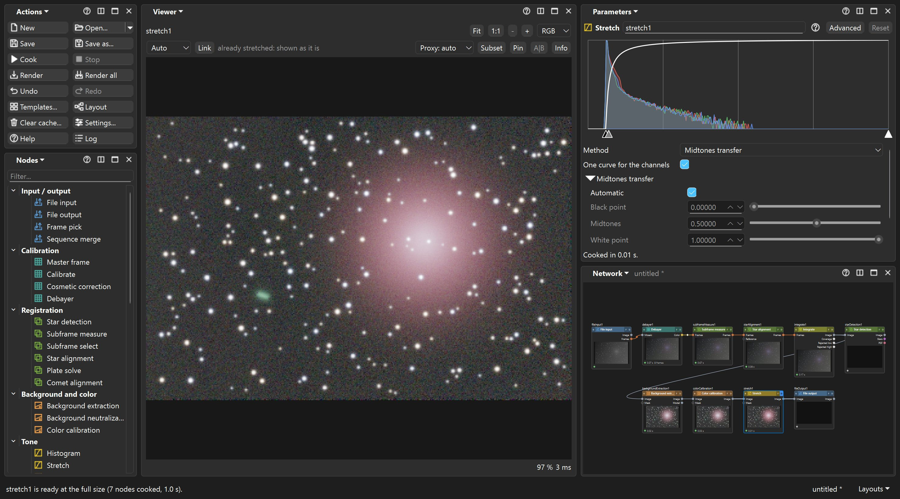

### Working in the tab

- **Panels** you arrange as you like - actions, nodes, viewer, parameters, network, in any number - and keep as named
  layouts.
- **The network editor**: drag nodes in, link them pin to pin, copy, paste, bypass, freeze, group in frames, notes; a
  thumbnail of every node's result; undo of every change.
- **The viewer** shows the result of the node you choose: an automatic or manual display stretch that never changes
  the image, a readout of every channel (and the sky position on a plate-solved image), a grid of the sky, the stars a
  node found, a mask over its image, and the marks and shapes a node lets you draw.
- **Proxies and a cache**: a smaller copy is shown at once while you change a setting and the full result follows;
  results are kept in a cache on disk, so only what changed is worked out again; a subset of a long sequence makes
  trials quick.
- **Projects** keep the network with its settings, with an autosave copy every five minutes; **Render** writes the
  outputs.

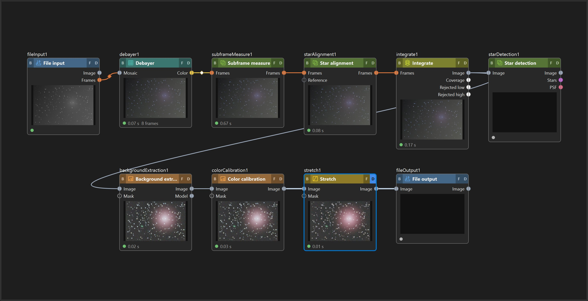

### Templates

Start from a ready-made network - **one-shot color**, **comet**, **mono LRGB** or **narrowband** - with only the
branches of the calibration frames you have, then change it as you like. Groups of nodes of your own are kept as
templates for every project.

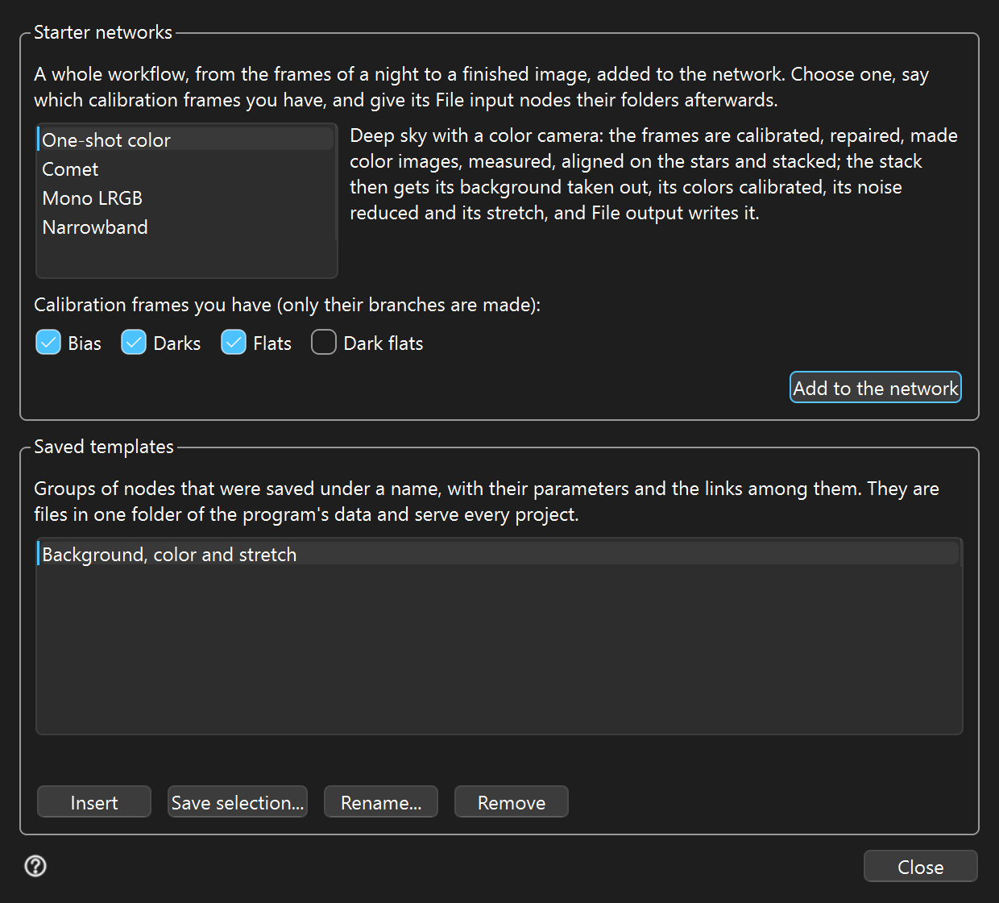

### The nodes

| Family | Nodes |
| --- | --- |
| Input and output | File input (FITS, TIFF, PNG, JPG: files, lists, folders with a pattern, filtered by filter, frame type, exposure, night or any header card), File output, Frame pick, Sequence merge |
| Calibration | Master frame, Calibrate, Cosmetic correction, Debayer (VNG, bilinear, superpixel) |
| Registration | Star detection, Subframe measure and Subframe select (FWHM, roundness, background, noise, SNR, with a plot and a table), Star alignment (also after a meridian flip), Plate solve, Comet alignment (by two marks, an ephemeris, or a rate and a position angle) |
| Integration | Integrate (normalization, weights, rejection: min/max, percentile, sigma, winsorized sigma, linear fit, ESD; local normalization), Comet integration, Drizzle, Mosaic (two to six plate-solved panels) |
| Background and color | Background extraction, Background neutralization, Color calibration (by the stars, a region, or photometrically with Gaia) |
| Tone and color | Stretch (midtones transfer, arcsinh, generalized hyperbolic, histogram equalization), Histogram, Curves, Color correction |
| Detail | Noise reduction (multiscale or total variation), Deconvolution, Local contrast |
| Masks | Star mask, Range mask, Shape mask (shapes you draw), Brush mask (painted), Morphology, Star reduction |
| Composition and utility | Blend (ten modes), LRGB combine, Narrowband combine (SHO, HOO and other palettes), Geometry, Data transform, Channel extract and combine, Pixel math |
| External tools | RC Astro BlurXTerminator, NoiseXTerminator and StarXTerminator, run through your own licensed copy of RC Astro's tools |

Every processing node has a mask input, so that it works only where the mask is white.

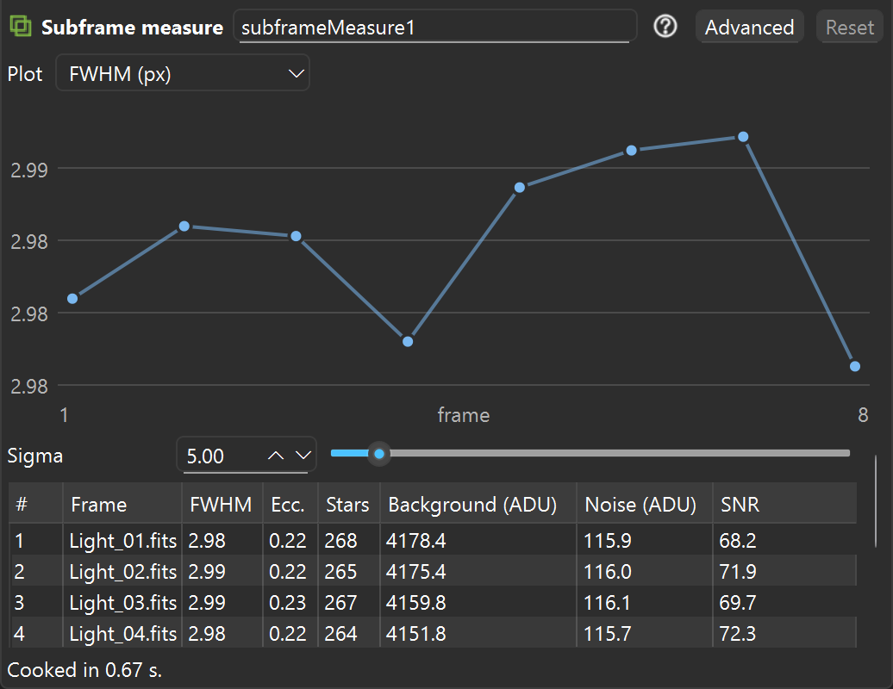

### Comets

**Comet alignment** holds a comet or an asteroid still through a sequence - by two marks you put on it in the viewer,
by an ephemeris, or by a rate and a position angle - and **Comet integration** then gives the comet without the stars,
the stars without the comet, and the two together. It combines the frames in turns on the stars and on the comet, each
time with the other taken out, so it also works when the comet moves too little between the frames for rejection to
clear the star trails.

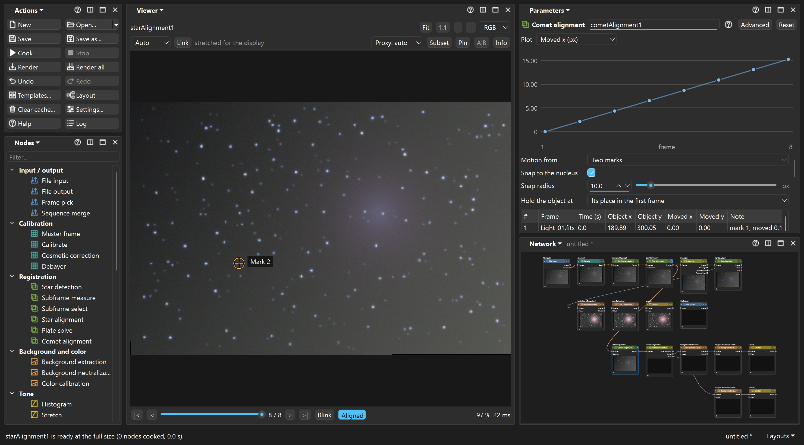

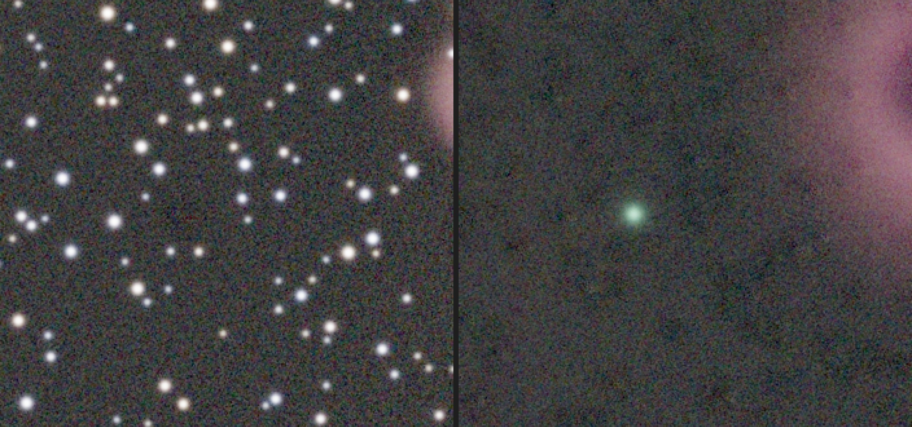

### Background, masks and local work

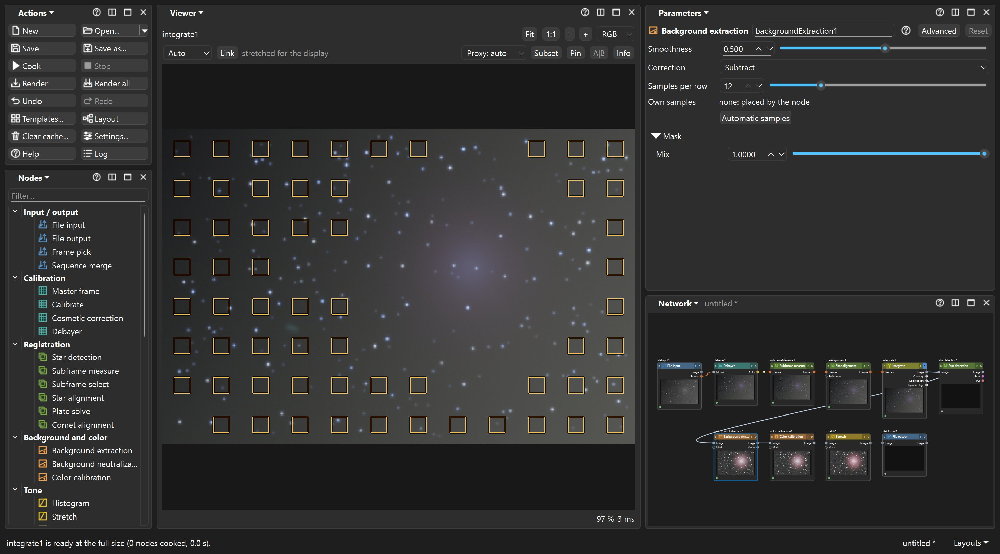

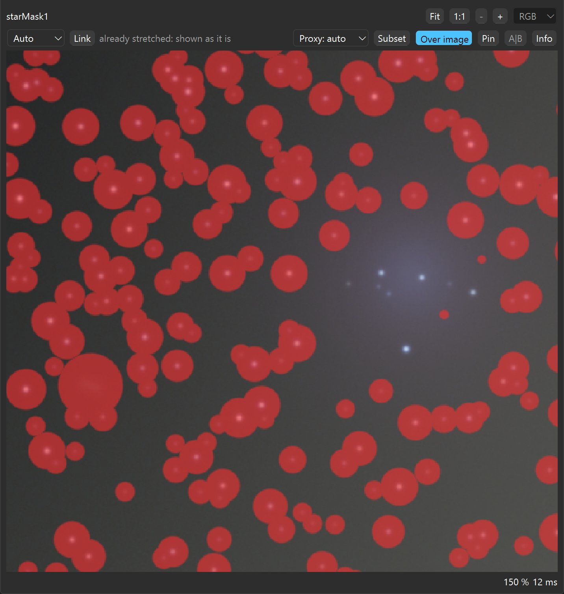

### Long sequences

Frames are read as they are needed and results are kept on disk, so a sequence may be much larger than the memory of
the computer: 200 color frames of 11.7 megapixels are calibrated, measured, aligned and integrated in about seven
minutes on an 8-core PC. The threads, the memory and the size of the cache are yours to set.

## The whole program

- **Help in the program**, in every language of the program: a user's manual, a reference of every control and every
  node, tutorials (planning a night, comet astrometry to the MPC, Image Processing basics, a deep-sky picture, LRGB and
  narrowband) and a glossary. **F1** or the **?** of a window opens the entry of what is under the mouse.
- **Languages**: English and Spanish.
- **Looks**: dark, light, or the one of your system.

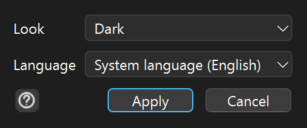

- **Privacy**: no account, no statistics, no tracking, no automatic update check. Public services are asked only for
  what a feature needs - a designation, an observatory code, a time, a field of the sky - and images, file names and
  equipment data are never sent.
- **Free**: freeware for any lawful use, on any number of computers ([LICENSE.txt](LICENSE.txt)).

## What JustComets needs

- Windows 10 or 11 (64-bit), a Mac with Apple silicon and macOS 14 or later, or a 64-bit PC with a Linux desktop
  (glibc 2.28 or newer).
- An internet connection for the positions of the planner, the ephemerides, the Gaia stars of a new field and sending
  reports; much of the rest works offline.
- Optional: [ASTAP](https://www.hnsky.org/astap.htm) as a second plate solver; RC Astro's tools for the three RC Astro
  nodes.

[Download JustComets](../../releases) &nbsp;&middot;&nbsp; [Back to the front page](README.md)
