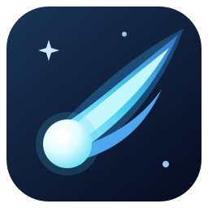
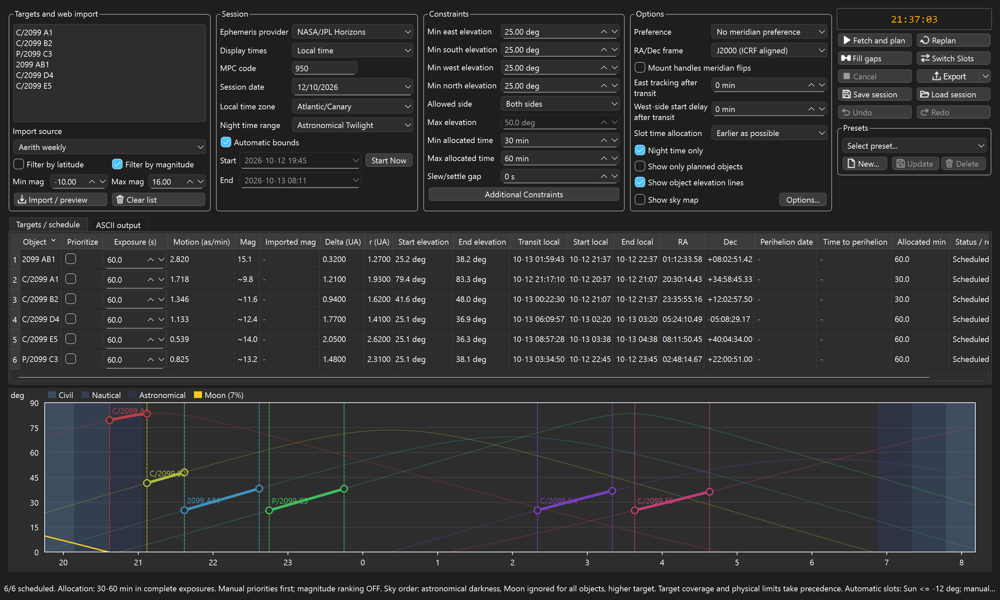
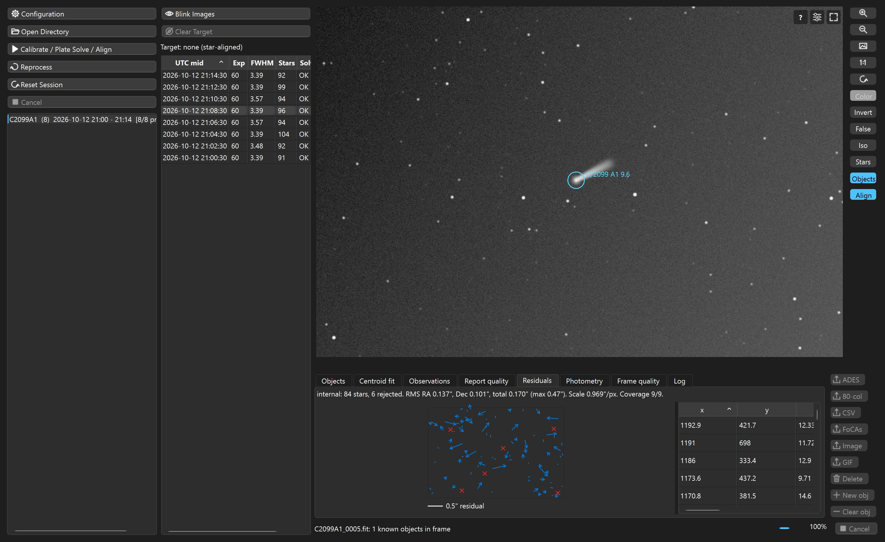
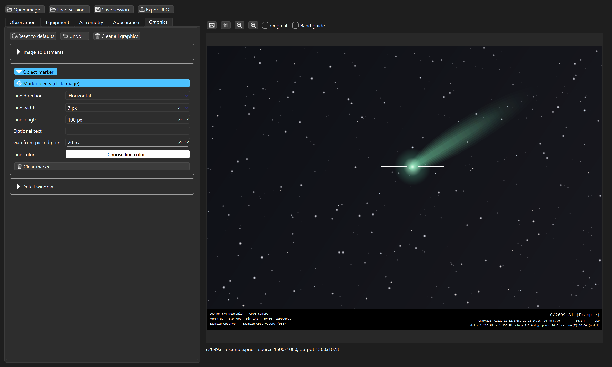
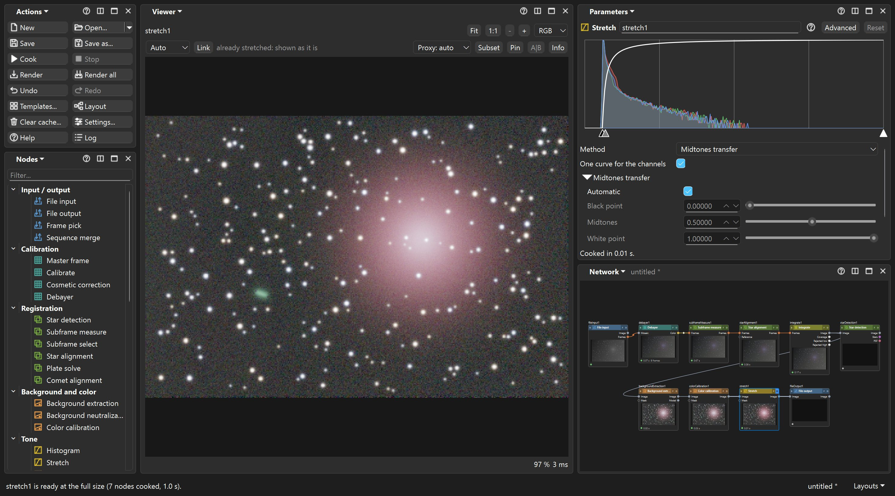

  

<h1 align="center">JustComets</h1>

  <b>Plan the night, measure and report your comets and asteroids, and make pictures to keep and to share - in one free program.</b>

  Windows &middot; Linux &middot; macOS &nbsp;&nbsp;|&nbsp;&nbsp; English &middot; Espa&ntilde;ol &nbsp;&nbsp;|&nbsp;&nbsp; Freeware

<!-- latest-version -->
**The first version is on its way.** Choose **Watch > Custom > Releases** at the top of this page to be told when it
is out.
<!-- /latest-version -->

---

JustComets is a desktop program for observers of comets and asteroids. It follows a
night from start to end: which targets are worth observing and when, where each target was and how bright it was,
the report for the Minor Planet Center, the finished picture, and an annotated image to share with the observation and
its details. Each part is a module of its own, so you can use
only the ones you need beside the programs you already have.

- **[The modules](#the-modules)** - what each one does, with a picture
- **[A tour of the features](FEATURES.md)** - everything JustComets does and how you work with it, without installing it
- **[Release notes](RELEASE-NOTES.md)** - what is new in each version
- **[Download and install](#download-and-install)** - Windows, Linux and macOS

> **Languages:** JustComets - the whole program and its help, with the user's manual, the tutorials and the
> reference - is in **English** and **Spanish** (*espa&ntilde;ol*). It follows the language of your system at first,
> and **Settings** changes it. These pages are in English.

> [!WARNING]
> **JustComets is in an early beta.** It is complete enough to be used and tried, but it has not yet been proven over
> many nights by many observers, and it can still make mistakes. Please check its results:
>
> - **Night plans.** A plan exported for N.I.N.A., KStars/Ekos, CCDCommander or the ASIAIR moves your mount by itself.
>   Look at every plan in the program that runs it, and run it at first with you beside the telescope, ready to stop
>   it, before you leave a night unattended. The planner plans within the limits you give it; it does not protect your
>   mount, so check its limits yourself.
> - **Astrometry and photometry.** Check every position and magnitude before you send a report to the Minor Planet
>   Center - the fit of each measurement, its O-C against the prediction, the frames themselves - and send to the
>   MPC's test service first. A report sent to the MPC's production service is published.
>
> You use JustComets at your own risk (see the [license](LICENSE.txt)).

## The modules

### Observation Planner

Which comets and asteroids can you observe tonight, when, and for how long? Give the planner your site, the night and
a list of targets: it fetches their positions from the Minor Planet Center or JPL Horizons, works out when each one is
high enough, the sky dark enough and the mount on the right side of the meridian, and fits one observing block per
target into the night.

- Targets typed by designation or name, or picked from lists: comets of the week, the MPC's possible comets, the
  newest comets, catalogs of asteroids and comets filtered by magnitude.
- Your horizon in four directions, twilight, the Moon, block lengths, the meridian rules of your mount.
- A graph of the night with every target's elevation, and blocks you can move, swap and fill by hand.
- Exports for **N.I.N.A.**, **KStars/Ekos (StellarMate)**, **CCDCommander** and the **ZWO ASIAIR**, ready to run.

[More about the planner](FEATURES.md#observation-planner)

### Astrometry and Photometry

From the frames of a night to a report for the Minor Planet Center. JustComets calibrates the frames, plate-solves
each one against the Gaia catalog, finds the known comets and asteroids in them, and lets you measure the target with
a double click - in single frames or in stacks that follow its motion.

- Plate solving with its own solver against Gaia (online, or offline from catalog files), or with ASTAP.
- Positions and magnitudes measured together, with the quality of the report graded before you send it.
- Comet photometry in the way of FoCAs (Cometas_Obs), ADES and 80-column reports, and sending to the MPC after your
  confirmation.
- Your positions compared with those of other stations, and annotated images and animated GIFs of the night.

[More about astrometry and photometry](FEATURES.md#astrometry-and-photometry)

### Image Annotation

A comet picture ready to share: a band under the image with the object's full name, your equipment, the exact
observation from your MPC report and the observing geometry - and marks that point at the object and enlarged details
of its coma.

- The observation taken from your MPC report (from Astrometry and Photometry or any other program), the full name
  and the distances, elongation, phase and magnitude of the night fetched online - or typed by hand.
- Your telescope, camera and site in the band, kept as presets for each setup.
- Marks on the object, and enlarged details in a corner, also in false color or with isophotes to show a coma's shape.
- A JPG named from the observation (`c2099a1-20261012-950.jpg`); the picture you opened is never changed.

[More about image annotation](FEATURES.md#image-annotation)

### Image Processing

From the frames of a night to a finished picture, in a network of nodes that you link and can change at any time:
the network keeps the recipe, not only the result, and no file you read is ever changed.

- Calibration, debayer, frame measurement and selection, alignment on the stars or on the comet, integration with
  rejection, drizzle and mosaics.
- **Comet integration**: the comet without the stars, the stars without the comet, and both together - also when the
  comet moves too little for the star trails to be rejected.
- Background, color calibration (also photometric, with Gaia), stretch, curves, noise reduction, deconvolution, local
  contrast, masks, LRGB and narrowband palettes, pixel math.
- Ready-made networks for one-shot color, comets, mono LRGB and narrowband; fast on long sequences of large frames.

[More about image processing](FEATURES.md#image-processing)

### In every module

- **Help in the program**: a user's manual, a reference of every control and every node, tutorials and a glossary,
  in English and Spanish. **F1** opens the entry of whatever is under the mouse.
- **Your data stays yours**: no account, no tracking; the internet is used only to ask public services for the data
  a feature needs, and much of the work goes on offline.
- A dark and a light look, or the one of your system.

## Download and install

Every version is on the [releases page](../../releases), with these files:

| System | File |
| --- | --- |
| Windows 10 and 11, 64-bit | `JustComets-<version>-setup-x64.exe` |
| Linux, 64-bit PC (glibc 2.28 or newer, such as RHEL / Rocky 8, Debian 10, Ubuntu 20.04 and later) | `JustComets-<version>-x86_64.AppImage` |
| macOS 14 Sonoma or later, Apple silicon | `JustComets-<version>-arm64.dmg` |

`SHA256SUMS.txt` on the same page has the SHA-256 checksum of every file. Please compare it with your download:
`Get-FileHash <file>` in Windows PowerShell, `sha256sum <file>` on Linux, `shasum -a 256 <file>` on macOS.

**Windows.** Run the setup. It can install for all users or for you only. The setup is not signed yet, so Windows
SmartScreen may show "Windows protected your PC": choose **More info**, then **Run anyway**. Uninstalling never
removes your observations, and keeps your settings unless you ask for them to be removed.

**Linux.** The AppImage is the whole program in one file: nothing is installed in the system.

1. Put the file where you keep programs, for example a folder `Applications` in your home folder.
2. Allow it to run: in the file manager, **Properties > Allow executing file as program**, or in a terminal
   `chmod +x JustComets-<version>-x86_64.AppImage`.
3. Start it with a double click, or with `./JustComets-<version>-x86_64.AppImage`. At its first start it asks
   whether to add itself, with its icon, to the applications menu; its **Settings** window adds or removes the entry
   later.

If it does not start and says that FUSE is missing (some recent systems no longer install it by themselves), install
your system's FUSE package, or start it with `--appimage-extract-and-run`. To update, put the new AppImage in place of
the old one and start it once: the menu entry follows it. To remove JustComets, remove the menu entry in **Settings**
and delete the file; your settings (`~/.config/JustComets`) and data (`~/.local/share/JustComets`) stay until you
delete them.

**macOS.** Open the disk image and drag **JustComets** to **Applications**. The app is not notarized by Apple, so
macOS refuses to open it the first time: open **System Settings > Privacy & Security** and choose **Open Anyway**
(once).

> JustComets is in an **early beta** (see the warning at the top of this page): check its plans and its measurements
> before you rely on them. Your reports of what does not work help it most ([below](#questions-and-bug-reports)).

## Other programs it can use

None of these is needed to start; none is part of JustComets.

- [ASTAP](https://www.hnsky.org/astap.htm) (free): an optional plate solver beside JustComets' own, which works
  without internet once its star database is installed.
- RC Astro's BlurXTerminator, NoiseXTerminator and StarXTerminator: three nodes of Image Processing run your own
  installed and licensed copy of RC Astro's stand-alone tools ([rc-astro.com](https://www.rc-astro.com/)).

## Online services and privacy

JustComets sends nothing to its author: no statistics, no tracking, no automatic update check. Some features ask
public services for data when you use them - the Minor Planet Center, NASA/JPL (Horizons and the Small-Body
Database), Gaia stars from CDS VizieR or ARI Heidelberg, and the weekly comet information of Seiichi Yoshida
(aerith.net) - and send them only what the question needs, such as a designation, an observatory code, a time or a
field of the sky. Images, file names and equipment data are never sent. A report goes to the Minor Planet Center only
when you send it and confirm. The user's manual lists every service and what it receives.

## License

JustComets is **freeware**: free of charge for any lawful use - personal, educational, scientific, club or
professional - on any number of computers. It is **not open source**; its source code is not published.

You may pass the program on, free of charge and unchanged, with its license files. The complete terms are in
[LICENSE.txt](LICENSE.txt) (the JustComets Freeware License, shown by the installer and in the program's **About and
Licensing** page); this summary does not replace them.

JustComets uses third-party components under their own licenses, listed in
[THIRD_PARTY_NOTICES.txt](THIRD_PARTY_NOTICES.txt): among them the Qt libraries under the GNU LGPL version 3 (where to
get their source is stated on every release page), and star, deep-sky and constellation tables adapted from HYG,
OpenNGC (both CC BY-SA 4.0) and d3-celestial (BSD 3-Clause).

## Questions and bug reports

Please open an [issue](../../issues), or write to [info@cieloprofundo.net](mailto:info@cieloprofundo.net) - also with
questions, ideas and requests for new features. It helps to give:

- the version (in the title of the main window and on the **About and Licensing** page) and your system;
- what you did, what you expected and what happened instead.

Please do not post anything you would rather keep private, such as your exact location or the headers of your image
files. E-mails to info@cieloprofundo.net are read by the author, Juanjo Gonzalez, and used only to answer them; they
are not passed on to anyone.
